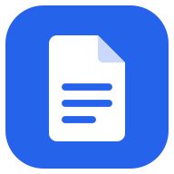
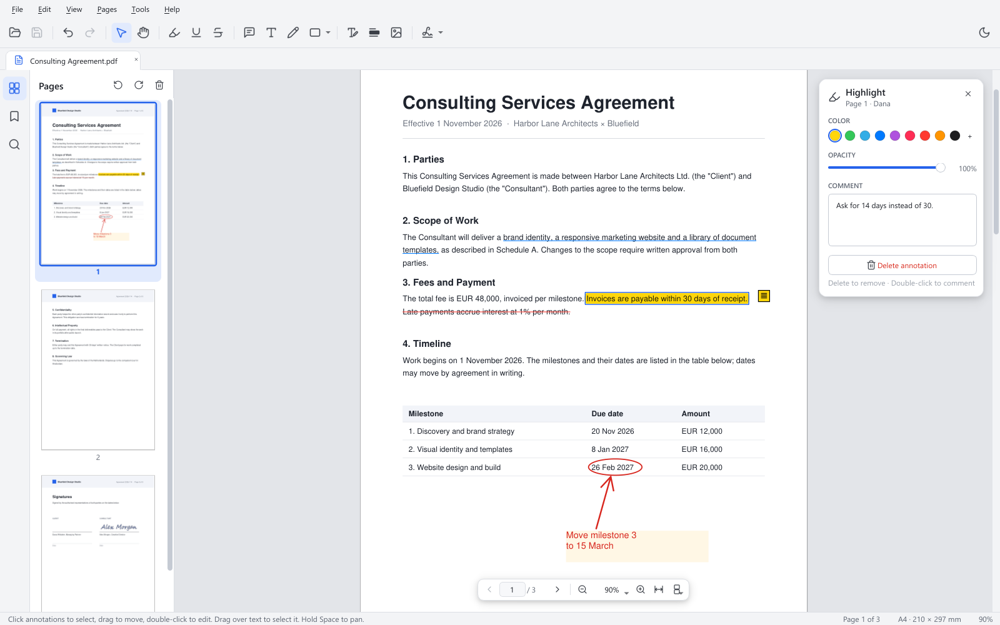
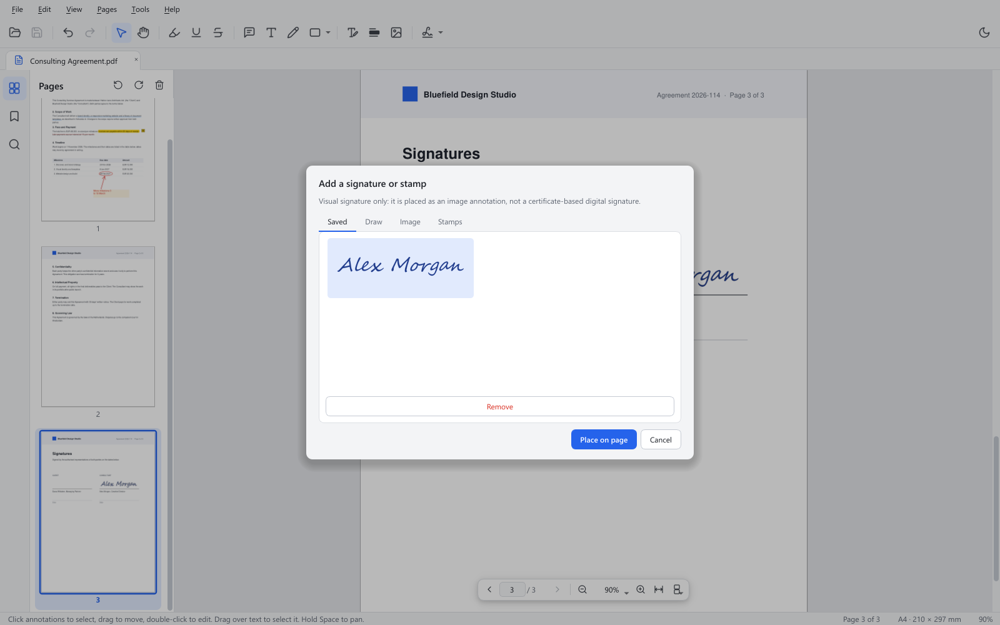
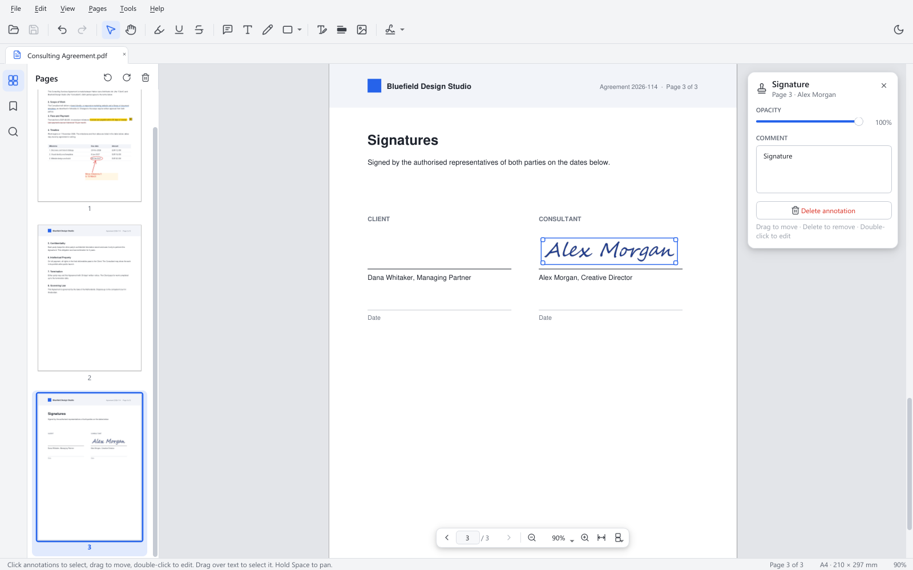
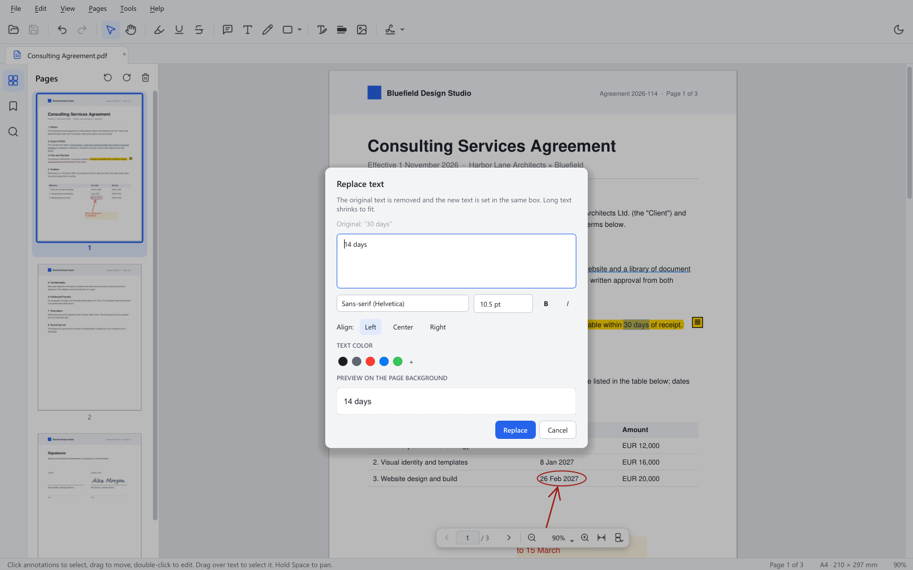
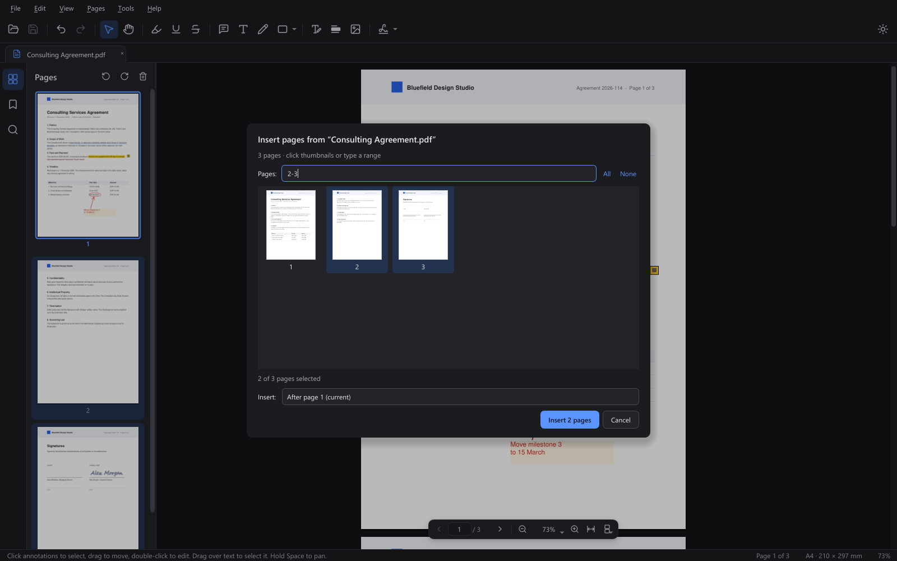
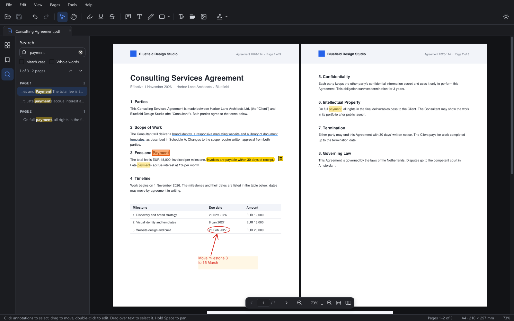

<p align="center">
  
</p>

<h1 align="center">PDF Studio</h1>

<p align="center">
  <b>Annotate, sign, organize and edit PDFs. Free, offline and fast.</b><br>
  It handles the everyday Acrobat jobs with no subscription and no sign-in.
</p>

<p align="center">
  <a href="https://github.com/Nikita-Yasenkov/PDFStudio/releases/latest/download/PDFStudio-win64.zip"><b>⬇ Download for Windows</b></a>
  &nbsp;·&nbsp; <a href="#quick-setup">Quick setup</a>
  &nbsp;·&nbsp; <a href="#features">Features</a>
  &nbsp;·&nbsp; <a href="#pdf-studio-vs-acrobat">vs. Acrobat</a>
  &nbsp;·&nbsp; <a href="#build-from-source">Build from source</a>
</p>



## Why PDF Studio

- **Free, with no account.** There is no subscription, no sign-in and no trial.
- **Private.** It never connects to the internet: no telemetry and no cloud
  uploads. Your documents and saved signatures stay on your PC.
- **Fast on big files.** Pages render in tiles that are cached, so scrolling
  and zooming stay smooth with hundreds of pages.
- **Forgiving.** Almost every action can be undone, even after you save:
  annotations, page moves, text edits and redactions.
- **Small.** The download is 46 MB, it runs without installing, and the
  optional install needs no administrator rights.

## Quick setup

1. **Download** [`PDFStudio-win64.zip`](https://github.com/Nikita-Yasenkov/PDFStudio/releases/latest/download/PDFStudio-win64.zip).
   It needs Windows 10 or 11, 64-bit.
2. **Unzip** it anywhere.
3. **Run** `PDFStudio\PDFStudio.exe`. It works straight from the folder.

> **Windows shows "Windows protected your PC"?** The app isn't code-signed yet,
> so SmartScreen warns the first time you run it. Click **More info → Run anyway**.

### Install it and open PDFs with it

In the app, open **Help → PDF Studio on This Computer…** and click
**Install for this user**. This:

- copies the app to `%LOCALAPPDATA%\Programs\PDF Studio`,
- adds **PDF Studio** shortcuts to the Desktop and the Start menu,
- registers it for `.pdf` files, so it appears in *Open with* and *Default apps*,
  and adds an uninstall entry to *Settings → Apps*.

`PDFStudio.exe --install` does the same from a terminal.

**To make it your default PDF app,** click **Make default PDF app…** in the same
dialog. Windows only lets you set the default yourself, so it opens Settings on
PDF Studio's page, where you choose it for `.pdf`. You can also right-click any
PDF, choose **Open with → Choose another app**, pick PDF Studio and select
**Always**.

After that, double-clicking a PDF opens it in PDF Studio. If PDF Studio is
already running, the file opens in a new tab.

**To uninstall,** use *Settings → Apps → PDF Studio → Uninstall*, or run
`PDFStudio.exe --uninstall`. This removes the app, its shortcuts and the file
association.

## Features

### Annotate

Highlight, underline and strike through text. Add sticky notes, text boxes,
freehand ink, rectangles, ellipses, lines and arrows. Click any annotation to
move or resize it, or to change its color, opacity and comment in the floating
inspector. The screenshot at the top shows these tools.

### Sign

Draw your signature with a mouse, pen or touchpad, or import it from an image.
Then place it on the page. Saved signatures are one click away next time.
Rubber stamps such as *Approved*, *Confidential* and *Draft* are included.

| Choose a signature | Placed on the page |
|---|---|
|  |  |

> Signatures are visual: an image on the page. They are not certificate-based
> digital signatures.

### Edit text, redact, replace images

Select text, press **E** and type the replacement. The original text is
removed from the page rather than covered up. The new text keeps the
original's size and color in a similar font, and a live preview shows the
result. **Redact** (**X**) permanently deletes the text and images under the
box. The **Image** tool (**G**) replaces a picture when you click it, or places
a new one in a box you drag.



### Organize pages

Drag thumbnails to reorder pages. You can rotate, delete and duplicate pages,
insert blank pages or pages from another PDF, and extract, split or combine
documents. These changes can be undone like any other edit.



### Read

The viewer offers continuous, single-page and two-page views, smooth zoom,
thumbnails, bookmarks, tabs and search that shows results as you type. Light
and dark themes are included, and it opens password-protected PDFs.



## PDF Studio vs. Acrobat

| | PDF Studio | Acrobat Reader (free) | Acrobat Pro |
|---|:-:|:-:|:-:|
| Price | **Free** | Free | Subscription |
| Account or sign-in | **None** | Optional | Required |
| Highlights, notes, shapes, ink | ✅ | ✅ | ✅ |
| Visual signatures and stamps | ✅ | ✅ | ✅ |
| Reorder, rotate, insert, delete pages | ✅ | — | ✅ |
| Extract, split, combine PDFs | ✅ | — | ✅ |
| Edit existing text | ✅ replace selected text | — | ✅ full paragraph editing |
| Redaction | ✅ | — | ✅ |

**Where Acrobat still wins.** PDF Studio does not (yet) do:

- OCR for scanned documents,
- filling in or creating PDF forms,
- certificate-based digital signatures and e-signature workflows,
- printing,
- exporting to Word or Excel,
- macOS or mobile apps. It runs from source on other systems, but only the
  Windows build is tested.

If your day is mostly reading, marking up, signing and reshuffling PDFs, PDF
Studio covers it.

## Keyboard shortcuts

**Help → Keyboard Shortcuts** (**F1**) lists all of them. The most used:

| Action | Keys | Action | Keys |
|---|---|---|---|
| Open / Save / Save As | Ctrl+O / Ctrl+S / Ctrl+Shift+S | Undo / Redo | Ctrl+Z / Ctrl+Shift+Z |
| Find / next / previous | Ctrl+F / F3 / Shift+F3 | Zoom in / out | Ctrl++ / Ctrl+- |
| Fit page / actual size / fit width | Ctrl+0 / Ctrl+1 / Ctrl+2 | Continuous / single / two-page | Ctrl+4 / 5 / 6 |
| Next / previous page | PgDn / PgUp | Go to page | Ctrl+G |
| Select / Hand | V / H | Highlight / Underline / Strike | M / U / K |
| Note / Text box / Draw | N / T / P | Rectangle / Ellipse / Line / Arrow | R / O / L / A |
| Edit text / Redact / Image / Sign | E / X / G / S | Rotate right / left | Ctrl+R / Ctrl+Shift+R |
| Pan temporarily | hold Space | Sidebar / dark theme | F4 / Ctrl+Shift+L |

## Build from source

You need Python 3.11+ and [uv](https://docs.astral.sh/uv/).

```powershell
git clone https://github.com/Nikita-Yasenkov/PDFStudio.git
cd PDFStudio
uv venv --python 3.12
uv pip install -e ".[dev]"
.venv\Scripts\activate

pdf-studio                          # run the app (pdf-studiow: no console window)
pdf-studio file.pdf other.pdf       # open files in tabs
python -m pytest -q                 # 308 tests, headless, about 50 s
```

The only runtime dependencies are **PyQt6** and **PyMuPDF**. Test documents
are generated on demand by `python -m pdf_studio.tests.fixtures.make_fixtures`;
`encrypted.pdf` opens with the password `secret`.

**Release build.** This command builds the one-folder app with PyInstaller in a
clean uv environment, runs a headless self-test of the bundle, and writes
`dist\PDFStudio-win64.zip`:

```powershell
.\scripts\build_pdf_studio.ps1 -Smoke -Zip      # add -Install to install it for your user
```

**Screenshots.** Run `python scripts\make_screenshots.py` to regenerate the
images in this README from the real app, using a fictional demo contract.

### How it's built

```
src/pdf_studio/
  pdf/          Qt-free PyMuPDF facade: rendering, text, annotations, page ops, editing
  core/         Qt-free logic: document session, undo commands, layout, caches, search
  ui/           PyQt6 app: main window, canvas, tools, panels, dialogs, themes
  integration/  Windows install, shortcuts and .pdf registration
  packaging/    PyInstaller build
  tests/        pytest suite and fixture generator
```

`pdf/` and `core/` never import Qt, and `ui/` and `core/` never import
PyMuPDF; a test enforces both rules. For the design, see
[`ARCHITECTURE.md`](src/pdf_studio/docs/ARCHITECTURE.md). For what each of the
42 build tickets delivered, see
[`PROGRESS.md`](src/pdf_studio/docs/PROGRESS.md).

## Built with

- [PyQt6](https://www.riverbankcomputing.com/software/pyqt/) (GPL v3), the Qt 6 user interface
- [PyMuPDF](https://pymupdf.readthedocs.io/) (AGPL v3), PDF rendering and editing on MuPDF
- [PyInstaller](https://pyinstaller.org/), the Windows bundle
